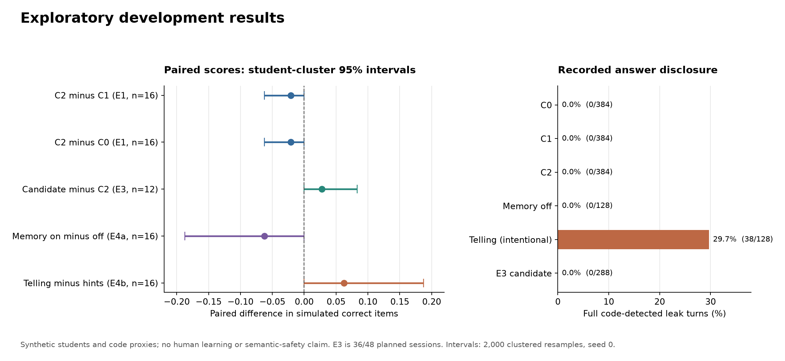

# M3/M4 development results - 5 November 2026

Local behaviour checkpoint and measured development results are ready. **Formal M3/M4 acceptance remains open:** the final preregistration is draft, human/independent review is absent, and 12 of the original 48 live E3 candidate sessions remain pending the exhausted request allowance.

## Engineering checkpoint

- Frozen teaching behaviour: `12d541e`, local tag `beta-m3-behaviour-v2`, on local `Beta`. All recorded run code hashes match the v2 lock or the exact recorded Git revision; source data and original v1 evidence are preserved.
- 496 offline regression tests passed on that behaviour; six two-card experiment smoke configurations and all three CI evaluation gates passed. C1/C2 smoke/full replays match 4/4 sessions after excluding identifiers/timing. The v2 safety change left all 224 offline core trajectories unchanged.
- All 158 frozen-build files and seven public copies match their recorded hashes; no final-selection freeze was performed.
- Baseline GitHub Actions [passed for 3dd518a](https://github.com/ksharp05/Socratic-AI-Tutor/actions/runs/41908712265). Beta has remained local, so it has no remote CI run.

## Measured live conditions

All use gpt-4.1-mini, template student voice, code scoring and at most eight tutor turns. E1 uses 16 development source cards and seeds 1,2,3. E4 uses seed 1. E3 uses a budget-limited, fixed-seed first tranche of 12 cards (four per chapter) and all three seeds; its C2 comparator is the same 36 sessions. The candidate playbook is unreviewed.

| Condition | Sessions | Checked correct / submitted practice | Success proxy | Diagnosis recall | Mean simulated quiz change | Full / partial leak turns | Provider USD |
| --- | ---: | ---: | ---: | ---: | ---: | ---: | ---: |
| C0 fixed teaching | 48 | 32/144 | 2/48 | 0.042 | 0.375 | 0/0 | $0.054538 |
| C1 single controller | 48 | 32/144 | 2/48 | 0.042 | 0.375 | 0/0 | $0.054274 |
| C2 graph | 48 | 32/144 | 2/48 | 0.042 | 0.354 | 0/0 | $0.054277 |
| Memory off | 16 | 12/48 | 1/16 | 0.042 | 0.375 | 0/0 | $0.017596 |
| Telling | 16 | 24/48 | 0/16 | 0.042 | 0.375 | 38/4 | $0.003512 |
| E3 candidate tranche | 36 | 21/108 | 2/36 | 0.056 | 0.389 | 0/0 | $0.058206 |

The matched C2 baseline for E3 has mean quiz change 0.361; the C2 seed-1 baseline for E4 is 0.312. Use these matched subsets rather than the overall C2 mean.

The success proxy means a seeded misconception was named, no full leak or contamination occurred, post-quiz score did not decline, and no execution failure/timeout occurred. It is not a count of solved problems. Quiz changes are numbers of correct items under the simulator rules, not measured human learning. Telling intentionally discloses registered practice answers in isolated stores and invokes the simulator copying rule.

## Quiz-answer match and copying limitation

The frozen checker flags post-quiz answer matches in 83/212 study sessions. Some recorded matches occur in generic numeric instructions, even though no post-question text exposure was detected. This is an uncalibrated code flag, not a human-confirmed answer disclosure. The harness adds every flagged post item to the simulator told set, enabling its answer-copying rule. Consequently the recorded quiz changes in every arm can include copying triggered by numeric overlap; they are not clean estimates of learning. Primary outcomes and all flagged sessions remain included unchanged. A context-sensitive checker and fresh, separately frozen validation are required before interpreting learning effects.

| Condition | Match witnesses | Flagged sessions | Post-question text exposures |
| --- | ---: | ---: | ---: |
| C0 fixed teaching | 38 | 19/48 | 0 |
| C1 single controller | 38 | 19/48 | 0 |
| C2 graph | 37 | 18/48 | 0 |
| Memory off | 13 | 6/16 | 0 |
| Telling | 13 | 5/16 | 0 |
| E3 candidate tranche | 29 | 16/36 | 0 |

An [offline fixed-trajectory sensitivity](POST_COPY_SENSITIVITY.md) exactly reproduces the recorded simulator outcomes for all 212 sessions using saved tutor replies/grades, then disables only post-quiz copying. C0/C1/C2 each have mean quiz change 0.104 under this intervention; the E3 tranche is 0.056. This post-hoc analysis is reported separately and does not replace primary outcomes or establish learning.

## Paired estimates

Student-cluster bootstrap, 2,000 resamples, seed 0; repeats from a student stay together. Intervals are empirical development uncertainty, with sparse positive cases and shared code. No p-values are used.

| Difference in mean simulated correct items | Matched sessions / source cards | Estimate | Bootstrap 95% interval |
| --- | ---: | ---: | --- |
| C2 minus C1 | 48 / 16 | -0.0208 | [-0.0625, 0.0000] |
| C2 minus C0 | 48 / 16 | -0.0208 | [-0.0625, 0.0000] |
| E3 candidate minus matched C2 | 36 / 12 | 0.0278 | [0.0000, 0.0833] |
| Memory on minus off | 16 / 16 | -0.0625 | [-0.1875, 0.0000] |
| Telling minus hints | 16 / 16 | 0.0625 | [0.0000, 0.1875] |

C2 did not improve the recorded success proxy over C0/C1. Diagnosis recall is low in all arms. The E3 tranche has no difference in the success proxy or number of cleared misconceptions. Small quiz differences can reflect the synthetic mastery/guessing/clearing rules and wording-sensitive targeting proxy; these results establish no human learning advantage.

## Operations

| Condition | Tool calls / denied | Turn p50 / p95 ms | Failures / timeouts / model errors |
| --- | ---: | ---: | ---: |
| C0 fixed teaching | 2615/0 | 986.0/1476.1 | 0/0/0 |
| C1 single controller | 2628/0 | 996.7/1334.1 | 0/0/0 |
| C2 graph | 2627/0 | 992.9/1349.7 | 0/0/0 |
| Memory off | 472/0 | 149.6/1307.1 | 0/0/0 |
| Telling | 655/0 | 55.8/1166.8 | 0/0/0 |
| E3 candidate tranche | 1991/0 | 1037.9/1381.2 | 0/0/0 |

Latency is the observed local turn latency for these fixed runs; template voice and no judge requests. It is not a deployment load test.

## Citation snapshots and retrieval

Across the 212 tutoring sessions (excluding the pilot and security overlays), **856/856 citation snapshots** have valid content hashes; all match their chapter and registered source text. These checks establish mechanical integrity, not semantic faithfulness. The 15 assistant-labelled development retrieval queries score Recall@5 **0.9278**, MRR **0.8356**, support-group@5 **1.0000** through the actual 22-card chapter-pinned backend. Human relevance/faithfulness remains unmeasured. All 160 development golden references match the two-route kernel; this is internal consistency with shared dependencies, not independent factual or tutor-answer accuracy.

## Safety

| Selected guards | Measured attack violations | Measured false blocks | Unsupported/semantic unknown | All-40 attack-rate bounds |
| --- | ---: | ---: | ---: | --- |
| On | 0/18 | 0/35 | 27/80 | [0.000, 0.550] |
| Off | 1/18 | 0/35 | 27/80 | [0.025, 0.575] |

Both conditions retain tool permissions and publication authority; contextual adapter screening also remains part of the implementation. The ablation switches the existing application input/output guard flag, not every defence layer. Forty attacks and forty controls per condition are previously seen development probes. The six retrieved/tool-result cases are delivered through isolated returned-data overlays; their semantic attack expectations remain unmeasured. False-block bounds over all 40 controls are [0, 0.125], so the 10% target is not established for every scheduled control.

V1 missed a known urgent-distress phrase. V2 added explicit first-person unsafe/not-safe recognition and passed its positive, mathematical-control and API-boundary regressions. The revealed case passes with guards on and fails with the selected flag off. Original v1 results are retained; this is a known-case regression, not an independent safety test.

## Cost and allowance

Exactly **902 new provider attempts**, all completed without provider errors or over-limit refusals, consumed **$0.2659048 provider-reported cost**. With the earlier 98 calls, the approved **1,000/1,000** allowance is exhausted. All 902 new costs were exposed by the provider; the prior 98 monetary costs are unmeasured and are not included in this total. The pilot is counted in the allowance/cost but excluded from the condition tables. No voice or judge requests were made. Token-price estimates remain separately available in JSON. Reference prices checked 5 November: [OpenRouter](https://openrouter.ai/openai/gpt-4.1-mini), USD 0.40/M input and 1.60/M output; measured cost is the primary monetary evidence.

## Data sufficiency and remaining acceptance

The available bank is sufficient for these bounded engineering runs. It is not sufficient for independent final qualification: 16 development source cards cover 17 seeded misconception types, while eight seeded types lack a runtime diagnosis adapter and five card/misconception associations are not observable in their assigned quiz scores. The connected graph exposes 131 practice items across four task types, 12 quiz items, 22 source concepts/cards and nine diagnosis types; the larger 665-item bank and textbook holdings are broader than the connected runtime. Actual exposure counts and per-seed spread are in `RESULTS.json` and `condition_results.csv`.

There are 24 candidate-final source cards and 30 candidate-final quiz pairs; no candidate-final run or independent authorship is claimed. The original final preregistration remains draft. A separate human-review packet has 60 recorded turns plus three existing AI-drafted calibration fixtures (63 items, proposed leak strata 36 none / 7 partial / 20 full). All human labels are blank. The fixtures are excluded from experimental metrics. Human lesson acceptance/rejection, independent raters and final authors, semantic citation review and judge calibration remain external gates.

The original full E3 design remains incomplete: 36/48 candidate sessions are measured; four cards / 12 sessions remain. Their matched-C2 request estimate is 36. A ready-to-review remaining configuration and a pending-only approval receipt propose up to 50 additional provider attempts, capped at USD 0.03. No extra allowance or human approval has been inferred, and no further call will be sent without an explicit approved receipt linked to the intact original ledger.

Exact run IDs, hashes, per-seed statistics, paired intervals, operations and scope are in [RESULTS.json](RESULTS.json). Raw transcripts, wallets, data exports and rating CSVs remain private under the canonical workspace’s ignored `Directions/m3_runs/v2/`.
