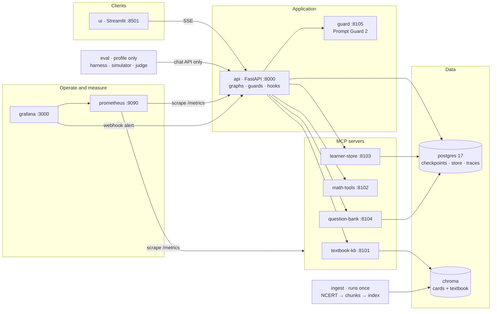
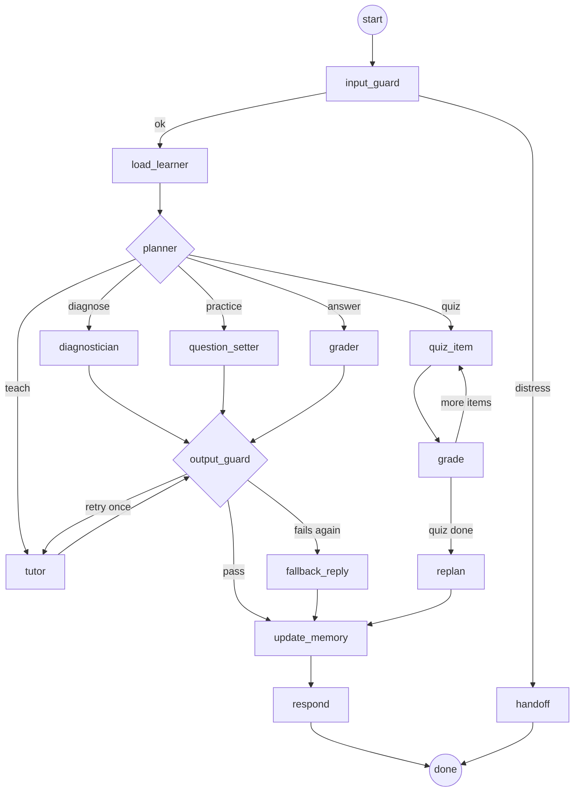
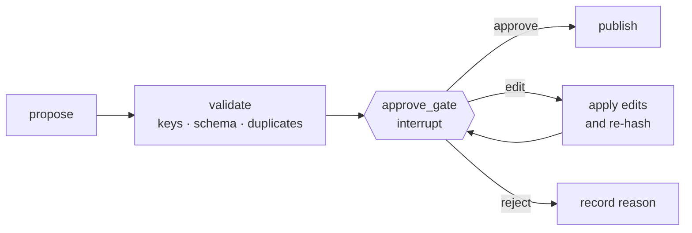
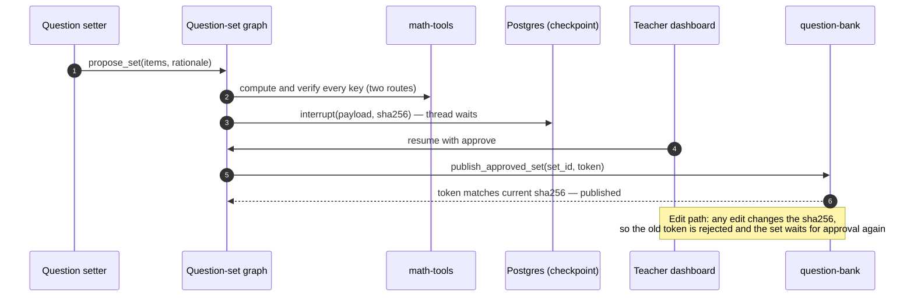
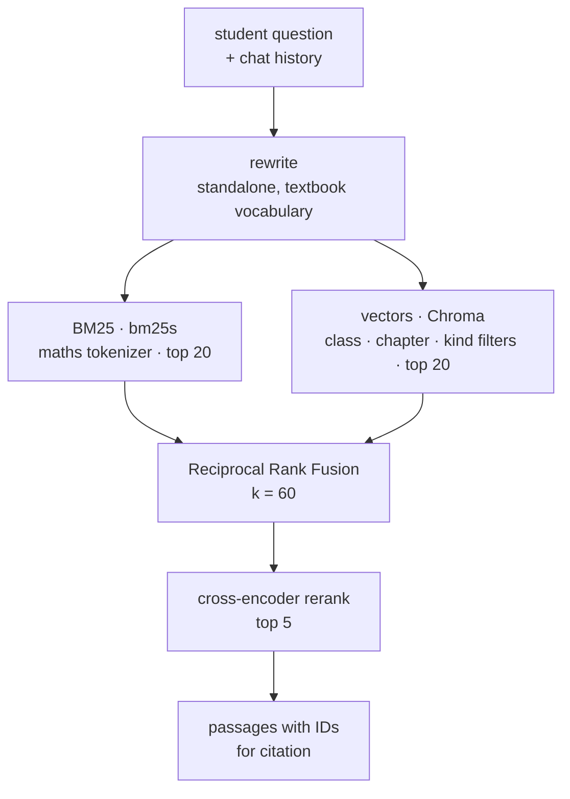

# 04 · Architecture

[← Decisions](03-decisions.md) · [Plan overview](README.md) · [Next: Evaluation →](05-evaluation.md)

**Contents:**
- [Services](#services)
- [One request, start to finish](#one-request-start-to-finish)
- [LangGraph design](#langgraph-design)
- [Agents](#agents)
- [MCP tools](#mcp-tools)
- [Hooks and permissions](#hooks-and-permissions)
- [Approval gate](#approval-gate)
- [Guardrails](#guardrails)
- [Learner model, memory and planner](#learner-model-memory-and-planner)
- [Answers and diagnosis](#answers-and-diagnosis)
- [Ingestion and retrieval](#ingestion-and-retrieval)
- [Prompts and configuration](#prompts-and-configuration)
- [API and UI](#api-and-ui)
- [Observability](#observability)
- [CI/CD](#cicd)

## Services

`docker compose up` starts every service below except `eval` and `langfuse`, which run only under their own profiles.



| Service | Image or base | Waits for | Health check | Notes |
|---|---|---|---|---|
| `postgres` | `postgres:17` | — | `pg_isready` | One database with four schemas:<br/>• `lg`: checkpoints and store<br/>• `learner`<br/>• `bank`<br/>• `obs`: traces |
| `chroma` | `chromadb/chroma:1.5.9` | — | `/api/v2/heartbeat` | Named volume at `/data` |
| `ingest` | `ml-base` (CPU torch, Docling or PyMuPDF) | chroma | exits 0 | Idempotent: skips if this corpus version is already indexed. Chunk IDs are deterministic |
| `guard` | `ml-base` + transformers | — | `/health` | Prompt Guard 2 86M; reads the Hugging Face token from `.env` |
| `mcp-*` (×4) | `app-base` (Python 3.12, uv) | postgres, chroma | `/health` | Only `math-tools` contains `socratic_data` |
| `api` | `app-base` | MCP servers, guard, postgres; ingest finished | `/health` | Exposes `/metrics`. Holds no answer keys, cards or evaluation data |
| `ui` | `app-base` + Streamlit | api | `/_stcore/health` | |
| `prometheus` | `prom/prometheus:v3` | — | — | Scrapes the API and the MCP servers |
| `grafana` | `grafana/grafana:13` | prometheus | — | Datasources, dashboards and alert rules come from files |
| `eval` | `app-base` + `socratic_data` | api | — | Profile `eval`. **The only service that mounts `eval/`**, and it mounts it read-only |

The stack needs roughly 3–4 GB of RAM. Give Docker Desktop's WSL2 at least 8 GB.

## One request, start to finish

The request, in practice mode, from learner `L-7f3a` (a pseudonym): *"I solved x² = 5x by dividing both sides by x and got x = 5. Why is there another answer?"*

1. **UI → API.** Streamlit sends `POST /chat` with a session token. The API takes the role (`student`), the learner ID and the mode (`practice`) **from the token**.
2. **Input guard** runs these checks in order:
   1. Length and rate limits.
   2. Redact personal data (phone, email, Aadhaar, person names) using Presidio and regular expressions.
   3. Distress lexicon in English, Hindi and Hinglish.
   4. Prompt Guard 2 on the message and on any pasted homework.
   5. Llama Guard 4 on the user's turn.

   - A distress signal goes to **handoff** (step 10).
   - Detected injection is treated as data, flagged, and never executed.
3. **`load_learner`** calls `learner-store.read_learner`. It returns:
   - mastery for all 25 concepts;
   - misconception flags;
   - explanation styles that worked;
   - the number of sessions spent on each concept;
   - the current study plan.
4. **`planner`** (gpt-4.1, structured output):
   - It chooses where to route: diagnose, tutor, set a question, grade, or quiz.
   - Code checks the concept it proposes against the allowed candidates and overrides an invalid choice.
   - The plan is streamed to the UI.
5. **Diagnostician.**
   - Calls `math-tools.diagnose_response`. This code finds that the answer "x = 5" matches the buggy rule for `qe_m04`.
   - Asks one probing question: *"What happens to x = 0 when you divide both sides by x?"*
   - Returns a typed diagnosis.
6. **Tutor.**
   - Calls `textbook-kb.search`, filtered by the hook to class 10, Quadratic Equations, and theory, example or card passages.
   - Adds at most two playbook lessons for `qe_m04`.
   - Uses the explanation style that worked for this learner before.
   - Writes a Socratic hint that cites `[normalized:qe04]` and `[ncert:jemh104:s4.3:c02]`.
7. **Output guard and self-correction loop.**
   - The code leak detector checks the draft against the item's key through `math-tools`. **The key never enters the model's context.**
   - The citation validator checks that every cited passage was actually retrieved.
   - Llama Guard 4 checks the agent's turn.

   On a failure, the draft goes back to the tutor once. If it fails again, a safe fallback hint is sent instead.
8. **`update_memory`** (code). Records the misconception event and the explanation style used, and runs the mastery update after any graded attempt. This needs no approval (see [why](06-security-and-privacy.md#why-the-mastery-write-needs-no-approval)).
9. **`respond`.** The reply streams over SSE as `token`, `plan`, `citation` and `done` events. Every step is now in the trace table, with cost and latency.
10. **Handoff** (only when step 2 detects distress). Tutoring stops. The student gets a fixed, human-written supportive message that names Tele-MANAS **14416 / 1-800-891-4416**. The teacher is alerted immediately, and the session is flagged.

**After a quiz:** every item is graded, mastery is updated, the planner must replan, and the stuck check runs (which may alert the teacher).

## LangGraph design

### State (`tutor/graph/state.py`, `TypedDict`)

| Key | Type / reducer | Notes |
|---|---|---|
| `messages` | `Annotated[list[AnyMessage], add_messages]` | Trimmed and summarised by middleware |
| `session` | `SessionCtx{session_id, learner_id, role, mode, started_at}` | Fixed after the start |
| `learner` | `LearnerSnapshot` | Loaded at the start; written back only through tools |
| `plan` | `StudyPlan{version, target_concepts, steps[], rationale, replan_reason}` | Shown to the user; `version` goes up on every replan |
| `active_item` | `ActiveItem{question_ref, concept_ids, hint_stage, attempts}` | `question_ref` is an opaque handle; keys stay on the server |
| `diagnosis` | `Diagnosis \| None` | Typed hand-off from the diagnostician |
| `retrieved` | `Annotated[list[PassageRef], operator.add]` | Used by the citation validator |
| `draft`, `checks`, `revision_count` | — | The output-guard loop |
| `budget` | `Budget{llm_calls, tool_calls, cost_usd}` | Updated by middleware |
| `safety` | `Safety{distress, blocked, reasons}` | |

### Student session graph



### Question-set graph

Each question set gets its own long-lived thread, `qs-<set_id>`.



### Rules for checkpointing and interrupts

- **Threads.** A student session is one thread (`thread_id = session_id`). A question set is a separate long-lived thread.
- **Live stop-and-resume demo.**
  1. `docker compose kill api` in the middle of a turn.
  2. Restart the API.
  3. `POST /chat/resume` calls `graph.ainvoke(None, config)` on the same thread, and the turn continues from its last checkpoint.
- **`approve_gate` contains only `interrupt(...)`.** A node restarts from its beginning on resume, so nothing else should run before the interrupt. The write happens in the separate `publish` node, keyed on `set_id` so that it cannot run twice.

## Agents

Every prompt has six slots: role, context, task, constraints, format and examples. Prompts are versioned files, described under [Prompts and configuration](#prompts-and-configuration).

| Agent (graph role) | Model, temperature | Tools | Output type | Must never |
|---|---|---|---|---|
| Supervisor / planner (`study_planner`) | gpt-4.1, 0.2 | `learner-store` reads and writes, through code nodes only | `PlanDecision{route, concept_id, action, rationale}` | Pick a concept outside the candidates computed by code; see answer keys |
| Diagnostician | gpt-4.1-mini, 0 | `textbook-kb.search` (cards only), `learner-store.read_learner`, `math-tools.diagnose_response` | `Diagnosis{misconception_id \| null, confidence, probe, evidence_refs}` | Name a misconception that is not in the catalogue |
| Tutor | gpt-4.1-mini, 0.3 | `textbook-kb.search`, `get_section`, `get_exemplar` | `TutorTurn{text, citations[], hint_stage, style}` | Give the final answer or a complete worked solution; cite a passage it did not retrieve |
| Grader | gpt-4.1-mini, 0 (rubric only) | `math-tools.parse_answer`, `check_equivalence`, `numeric_check` | `GradeResult{status, scorable, feedback_points, rubric?}` | Override a verdict from code |
| Question setter | gpt-4.1-mini, 0.2 | `question-bank.list_published`, `select_items`, `propose_set`; `math-tools.solve` | `ItemChoice` / `SetProposal` | Publish a set; see answer keys (`solve` returns only whether the key was verified) |

## MCP tools

Every tool has typed Pydantic inputs and outputs and returns structured errors. Business errors raise `ToolError` with one of these codes: `NOT_FOUND`, `FORBIDDEN`, `INVALID_INPUT`, `UNVERIFIED` or `BUDGET`.

Read tools carry `readOnlyHint=True` and write tools carry `destructiveHint`. **These annotations are only hints; the hooks are what enforce permissions.**

| Server.tool | R/W | Input → output | Allowed roles | Name in dataset contracts |
|---|---|---|---|---|
| `textbook-kb.search` | R | `query, class=10, chapter?, kinds?, k=5` → passages with `passage_id, section, page, kind, text, source_url, retrieved_at, score` | tutor, diagnostician, study_planner | security and benchmark `search` |
| `textbook-kb.get_section` | R | `passage_id` → passage | tutor | benchmark `get_section` |
| `textbook-kb.get_exemplar` | R | `chapter, concept_id?, k` → exemplar problems, without solutions | tutor, question_setter | — |
| `math-tools.solve` | R | `question_ref` → `{verified, routes_agree}`. **The key stays on the server** | question_setter | — |
| `math-tools.check_equivalence` | R | `question_ref, response` → `{status, scorable, reason}` | grader | security `check_equivalence` |
| `math-tools.parse_answer` | R | `text, answer_contract` → a typed answer, or `needs_clarification` | grader | — |
| `math-tools.numeric_check` | R | `value, expression, tolerance` → true, false or unverified | grader | — |
| `math-tools.evaluate_expression`, `expressions_equivalent` | R | expressions → value or true/false | tutor, grader | benchmark aliases |
| `math-tools.diagnose_response` | R | `question_ref, response` → candidate misconception IDs, with the rule that matched | diagnostician | — |
| `learner-store.read_learner` | R | `learner_id` → `LearnerSnapshot` | study_planner, diagnostician, tutor (own learner only) | security `read_learner` |
| `learner-store.update_mastery` | W | `learner_id, concept_id, p_mastery, evidence_ref` | study_planner, grader | security `update_mastery` |
| `learner-store.record_misconception`, `record_explanation` | W | `learner_id, misconception_id, status or outcome, evidence_ref` | study_planner | — |
| `learner-store.update_profile` | W | `learner_id, preferences` (fixed-choice fields only; **free text is rejected**) | study_planner | security `update_profile` |
| `learner-store.forget_learner` | W | `learner_id` → deletion receipt | teacher, through the API only (never an agent) | — |
| `question-bank.list_published`, `select_items` | R | filters → published items | question_setter | — |
| `question-bank.propose_set` | W | `items[], rationale` → `{set_id, payload_sha256}` | question_setter | security `propose_set` |
| `question-bank.publish_approved_set` | W | `set_id, approval_token` → publishes only if the token matches the current payload's hash | **the graph's `publish` node only; never an LLM** | security `publish_approved_set` |
| `control.handoff` | W | `reason, severity` → handoff record and teacher alert | API guard code | security `handoff` |

**Tests:** `tests/mcp/test_<server>.py` has at least one test per tool, using an in-memory `fastmcp.Client(server)`. Each server's tests cover a normal call, a structured error and a permission denial.

## Hooks and permissions

One middleware, `tutor/guardrails/hooks.py`, built on `wrap_tool_call`, runs around every tool call.

**Before the tool runs:**

1. **Role allowlist.** Uses the role column of the MCP tools table. A denied call becomes an error result marked `FORBIDDEN`, plus a trace event.
2. **Argument rules.**
   - `learner_id` must equal the session's learner. This blocks reading or writing another learner's data.
   - `textbook-kb` filters are forced to class 10, and to the passage kinds allowed in the current mode.
3. **Mode rules.**
   - Quiz mode: no hint or explanation tools, and the tutor is not called.
   - Practice mode: no tool returns a full solution, and `get_exemplar` strips solutions.
4. **Budget.** Tool calls and dollars, counted per turn and per session. Call-limit middleware backs this up.

**After the tool runs:**

1. Wrap the result as untrusted data.
2. Scan text results (retrieved passages, pasted homework) with Prompt Guard 2, then drop and count any malicious segments.
3. Write a trace event: tool, role, argument hash, outcome and latency.
4. Update the Prometheus counters.

## Approval gate



1. The question setter proposes 5–10 items for a concept and difficulty band.
2. Code validates the set:
   - Each key is computed with `primary_answer` and checked against `oracle_answer`.
   - It also checks the schema, rejects duplicates, and checks concept coverage.
3. `approve_gate` calls `interrupt({set_id, payload, payload_sha256, diff_from_last})`.
4. The teacher's dashboard lists waiting sets. The teacher's decision resumes the thread:
   - **Approve.** The token is `HMAC(server_secret, payload_sha256 + teacher_id)`. The publish step re-hashes the current payload and checks it against the token.
   - **Edit.** The edits are applied and the payload is hashed again. The old token stops working, and the set returns to the gate.
   - **Reject.** The reason is stored.
5. **Live demo.** Approve the set, then edit one item. Publishing with the old token now fails with `FORBIDDEN: payload changed`. Approve again, and the set is published.

Real students see only approved sets. Evaluation runs use a separate database seeded with fixture items labelled `eval_fixture_unapproved`, and those items are never presented as approved.

## Guardrails

| Layer | Check | On a hit |
|---|---|---|
| Edge | Length and rate limits; Presidio and regex redaction before any model call or log write | Redact, then continue |
| Distress | Lexicon (English, Hindi, Hinglish) **or** Llama Guard 4 category S11 | Immediate handoff; tutoring stops. If the guard fails, a lexicon hit still triggers handoff (fail closed) |
| Injection | Prompt Guard 2 86M on user turns, homework, retrieved passages and tool results, in 512-token segments | Treat as data; drop the segment; count it |
| Safety | Llama Guard 4 on the user's turn; categories S1–S4, S9, S10 and S12 are blocked | Refuse with an age-appropriate message |
| Role | The role comes only from the token, so "I'm the teacher" changes nothing; answer keys never enter model context | Refuse politely and count the attempt |
| Output: leak | Code checks for the final answer (equivalent in SymPy) or a worked-solution pattern before the student has produced it | Revise once, then send the fallback |
| Output: citations | Every cited passage must have been retrieved; formulas must cite cards | Revise once |
| Output: safety | Llama Guard 4 on the agent's turn; personal data scrubbed | Block and send the fallback |

**After the last hint** (R1 owns this policy): after 3 hint stages and 2 failed attempts, the tutor offers a **parallel worked example** with the same structure and different numbers. It never gives the solution to the active item, and marks that item for a later revisit.

## Learner model, memory and planner

### Mastery: Bayesian Knowledge Tracing (`tutor/memory/bkt.py`)

After each scorable graded attempt on concept *c*:

- **Correct:** P′ = P(1 − S) / (P(1 − S) + (1 − P)G)
- **Incorrect:** P′ = P·S / (P·S + (1 − P)(1 − G))
- **Then learning:** P_next = P′ + (1 − P′)·T

**Starting parameters.** These are documented heuristics, not values fitted to children:

| Parameter | Value |
|---|---|
| P₀ (initial mastery) | 0.25 |
| T (learning rate) | 0.15 |
| S (slip) | 0.10 |
| G (guess), numeric, set or coefficient answers | 0.05 |
| G (guess), true/false answers | 0.5 |
| G (guess), classification answers | 1 / number of labels |

**Edge cases:**
- An answer that is correct only after 2 or more hints gets no observation update; only T applies.
- An answer the grader cannot score gets no update at all.

**Thresholds:**
- **Mastered:** P ≥ 0.95 (sensitivity checked at 0.90 and 0.98).
- **Prerequisite ready:** P ≥ 0.80.

### Misconceptions and what worked

Each misconception moves through four states:

| State | Reached when |
|---|---|
| **Suspected** | One piece of evidence (a code match or an LLM diagnosis) |
| **Confirmed** | Two independent pieces of evidence |
| **Addressed** | A targeted hint has been delivered |
| **Resolved** | Two later correct answers on that concept, without the buggy pattern |

**What worked.** A table of (learner, misconception, explanation style) with success counts. A style counts as a success when the next scorable attempt is correct. The styles are: counterexample, substitute and check, table or pattern, diagram description, analogy, and reverse question.

### Planning over the prerequisite graph

Code computes the **outer fringe**: unmastered concepts whose prerequisites are all ready. It ranks them by:

1. a confirmed misconception on the concept (fix it first);
2. the session's target chapter;
3. how many later concepts it unlocks;
4. lowest mastery.

Further rules:
- A concept failed twice triggers a re-test of its weakest prerequisite.
- The LLM planner may only reorder the top 3 candidates, and must give a reason.

**Replanning** happens:
- after every quiz (mandatory);
- whenever a result contradicts the plan, for example when the grader fails a concept the plan assumed was mastered, or a diagnosis points to a misconception in a prerequisite.

Each replan increases `plan.version` and logs a `replan_reason`. That log is the evidence for L10.

**Stuck alert.** If the same focus concept lasts 3 sessions in a row and mastery rises by less than 0.10 across them, the teacher gets an alert with the evidence.

### Memory

- **Short-term:** a summarisation middleware triggers at about 6,000 tokens and keeps the last 8 messages. Summaries contain no personal data.
- **Long-term store namespaces:**
  - `("learner", id)`: the learner's state and history.
  - `("playbook", misconception_id)`: approved lessons.
  - `("class", class_id)`: aggregates for the dashboard.

### Two-learner demo (`tr_m08`)

Both learners ask: *"Is sin 30° bigger in a bigger triangle?"*

| | Learner A | Learner B |
|---|---|---|
| Learner model | `tr_m08` confirmed; responds well to counterexamples | `tr04` mastered; no misconception |
| Tutor's response | A probing question, then a counterexample with similar triangles | A short confirmation, then an extension question |
| Plan afterwards | Goes back to `tr04` | Moves on to `tr05` |

The trace shows the different routes, explanation styles and plans.

## Answers and diagnosis

### Answer adapter (`math-tools.parse_answer`)

**The rules run first:**
- Normalise Unicode and LaTeX (`\frac`, `\sqrt`, `^`, `·`, `×`, `−`).
- Make implicit multiplication explicit.
- `sin 30°` becomes `sin(30*pi/180)`, because the maths kernel works in radians.
- `x = 0 or 5` becomes the set {0, 5}.
- Accept unit synonyms such as kmph, km/h and km/hr.
- Pass decimals as strings.

**If the rules cannot decide,** an LLM may only reformat the answer: structured output, temperature 0, and no judgement of correctness.

The student sees the parsed answer for confirmation: *"You answered {0, 5}. Is that right?"* If the answer still cannot be parsed, the tutor asks for a supported form and never infers a misconception from it.

### Grading

`grade_mathematics(parsed, key)` runs inside `math-tools`. Explanations ("why") are scored against the rubric by an LLM. That score is advisory and never changes the numeric verdict.

### Buggy-rule diagnosis (`tutor/diagnosis/rules.py`, written by R2/R3)

There is one function per misconception for each task type it applies to. Examples:

| Misconception | What the buggy rule does |
|---|---|
| `ap_m03` | Computes a + n·d instead of a + (n − 1)·d |
| `qe_m04` | Drops the root 0 |
| `qe_m05` | Keeps only the positive square root |
| `tr_m05` | Evaluates sin(θ²) instead of (sin θ)² |

`diagnose_response` returns every misconception whose rule reproduces the student's answer. Misconceptions that show up only in explanations are left to the diagnostician's probing questions.

The simulator uses **its own, separately written** rules ([D17](03-decisions.md#d17--simulated-students-code-owns-the-state)).

## Ingestion and retrieval

### Sources

- NCERT chapters 4, 5 and 8 (`jemh104`, `jemh105`, `jemh108`).
- Exemplar `jeep204`, `jeep205` and `jeep208`: **problems only**; solutions are not indexed.
- Our 25 cards.

The `ingest` service downloads the PDFs from `ncert.nic.in` and checks the recorded SHA-256 hashes. If NCERT has reissued a file, it records the new hash and warns.

### Chunking (`tutor/retrieval/chunk.py`)

- Split on section numbers (4.1, 4.2, …).
- Keep "Example n" together with its "Solution".
- Make each exercise question its own chunk.
- **Never split inside a display equation**, and attach each equation to the sentence before it.
- Keep tables intact.
- Cap chunks at about 350 tokens.
- Chunk IDs are deterministic, for example `ncert:jemh104:s4.3:c02`, `exemplar:jeep204:p12:q5` and `normalized:qe04`.

**Metadata on every chunk:**

| Field group | Fields |
|---|---|
| Curriculum | class, subject, chapter, chapter number, section number, section title |
| Kind | theory, example, exercise, exemplar problem or card |
| Location | PDF page, printed page |
| Source | source ID, URL, SHA-256, edition, retrieval date |
| Processing | extractor and its version; formula-check status |

### Retrieval pipeline (`tutor/retrieval/hybrid.py`)



**The maths tokenizer** normalises Unicode (NFKC) and maps θ → theta, √ → sqrt, ² → ^2 and ± → pm. It keeps tokens such as `a_n`, `S_n` and `b^2-4ac` intact.

**Pre-registered "one change"** for the before/after comparison: **adding the cross-encoder reranker**, measured on both labelled sets ([Retrieval evaluation](05-evaluation.md#retrieval-evaluation)). Query rewriting is reported as an exploratory second ablation if time allows.

**Benchmark mode:** `textbook-kb` serves only the `cards` collection, because the benchmark scorer accepts only exact card text.

## Prompts and configuration

**Prompt files.**
- Each prompt is a file `prompts/<agent>.md` with front matter (`id`, `version`, `model_role`, `temperature`, `max_tokens`) and all six slots.
- A unit test checks that every agent, critic, judge, reflection and rewrite prompt has the six slots.

**Configuration** (`config/app.yaml`, skeleton in the [appendix](appendix.md#a-configuration-skeleton)). It holds:
- model IDs, temperatures and context limits;
- budgets;
- learner-model parameters;
- feature flags;
- prompt versions.

**Run manifests.** Every run manifest records the hashes of the config, prompts and playbook.

**Experiment configs** (`eval/configs/*.yaml`) override only the keys they change.

**Temperatures:**

| Use | Temperature |
|---|---|
| Routing, grading, diagnosis, the judge and quiz handling | 0 |
| Tutor wording | 0.3 |
| Simulated students | 0.7 |

Summarisation keeps the context short, so we never need very long context windows.

## API and UI

**Student endpoints:**
- `POST /auth/login`, using demo accounts in `config/users.yaml` with salted password hashes.
- `POST /chat`, which streams over SSE.
- `POST /chat/resume`.
- `GET /session/{id}/plan`.

**Teacher endpoints:**
- `GET /teacher/class`
- `GET /teacher/approvals` and `POST /teacher/approvals/{set_id}`
- `GET /teacher/alerts`
- `GET /teacher/lessons` and `POST /teacher/lessons` (lesson review)
- `DELETE /learners/{id}`

**Other endpoints:**
- `POST /alerts/grafana`
- `/metrics` and `/health`

**Streamlit pages, chosen by role:**
- **Student:**
  - **Chat:** a practice/quiz toggle, a plan panel, and citations shown as expandable source cards.
  - **My progress.**
- **Teacher:**
  - **Class misconceptions:** a heatmap of concepts against misconceptions.
  - **Approvals:** a diff, the payload hash, and approve, edit or reject.
  - **Alerts:** stuck students and distress handoffs.
  - **Lessons:** the review queue.
  - **Cost and leaks:** cost per session, leak rate, and mastery change by concept.

## Observability

### Traces: `obs.trace_events` (Postgres)

**Fields:**
- `ts`, `run_id`, `session_id` (a pseudonym), `thread_id`;
- `node`, `agent_role`, `kind` (llm, tool, guard or decision);
- `model`, `prompt_version`;
- `tokens_in`, `tokens_out`, `cost_usd`, `latency_ms`;
- `status`, `error`, `payload_ref` (scrubbed).

**Written by:** a LangChain callback (model calls), the post-tool hook (tool calls) and the guard functions.

**Read with:** `scripts/trace.py <session_id>`, which prints a numbered walkthrough of the session. The viva uses this output.

### Prometheus metrics

Labels stay bounded: at most 25 concepts and 30 misconceptions.

| Type | Metrics |
|---|---|
| Counters | `tutor_requests_total{mode,route}`, `tutor_replies_total{mode}`, `tutor_llm_tokens_total{model,direction}`, `tutor_llm_cost_usd_total{model,agent}`, `tutor_tool_calls_total{server,tool,outcome}`, `tutor_answer_leak_total{mode,detector}`, `tutor_guard_blocks_total{layer,category}`, `tutor_handoffs_total{reason}`, `tutor_replans_total{trigger}`, `tutor_misconception_detected_total{misconception_id}`, `tutor_stuck_alerts_total` |
| Histograms | `tutor_turn_latency_seconds{route}`, `tutor_llm_latency_seconds{agent}`, `tutor_session_cost_usd`, `tutor_mastery_delta{concept}` |
| Gauge | `tutor_pending_approvals` |

### Grafana

**Dashboards**, provisioned from JSON files:
1. **Teaching:** misconceptions by concept, leak rate, mastery change, pending approvals, cost per session.
2. **System:** p50 and p95 latency by agent, errors, tool outcomes, guard blocks, daily cost, replans.

**Alert:** managed by Grafana and provisioned from files.
- **Rule:**
  ```
  sum(increase(tutor_answer_leak_total[10m])) / clamp_min(sum(increase(tutor_replies_total[10m])), 1) > 0.05
  ```
  sustained for 2 minutes.
- **Contact point:** a webhook to `http://api:8000/alerts/grafana`, which writes to the teacher's alert feed.
- **Demo:** `scripts/fire_leak_alert.py` runs a deliberately leaky configuration on 20 development items to make the alert fire. Capture it for the report.

## CI/CD

GitHub Actions workflow (`.github/workflows/ci.yml`):

1. **`test`**
   - `uv sync --locked`, `ruff` and `pytest`: unit tests, tool tests, hook tests and a check that every prompt has all six slots.
   - Hugging Face models are cached between runs.
2. **`eval-gate`.** No LLM calls and no secrets. It fails below the thresholds in `config/eval_gate.yaml`:

   | Check | Threshold |
   |---|---|
   | Recall@5 on the 42 card queries | At least the recorded baseline minus 0.05 |
   | `math-tools` keys against all 610 benchmark keys and all 104 quiz keys | 100% agreement |
   | Grading fixtures | 10 of 10 |
   | Answer-adapter fixtures | At least 95% |
   | Leak-detector precision and recall | Both at least 0.9 |
   | Code-level security checks | 100% |

   The code-level security checks cover role-from-token, cross-learner access, the payload-hash token and free-text profile updates. The job writes `reports/eval_gate.md` to the run summary, prints a `::error` annotation for each failing metric, and uploads the report as an artifact.
3. **`compose-smoke`.** `docker compose up -d --wait`, then check `/health` and `/metrics`, then run one scripted session against a stub LLM, then `down -v`.
4. **`live-eval`.** Started by hand only. Uses the OpenRouter secret on 10 development cases, with a cost cap.

**The failed CI run** (required evidence), on Sun 8 Nov:
1. Open pull request `demo/eval-regression` with one honest regression: a chunk-size change that splits display equations, dropping section Recall@5 below its gate.
2. The gate fails. Explain the run in `Docs/ci_failure.md`.
3. Fix the change and re-run.

GitHub keeps run logs for 90 days, so **save screenshots and the artifact.**

---

[← Decisions](03-decisions.md) · [Plan overview](README.md) · [Next: Evaluation →](05-evaluation.md)
