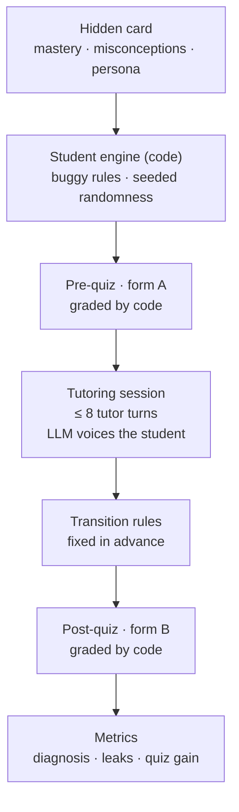
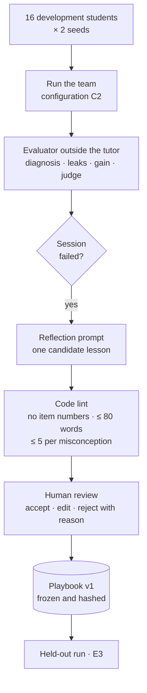

# 05 · Evaluation

[← Architecture](04-architecture.md) · [Plan overview](README.md) · [Next: Security and privacy →](06-security-and-privacy.md)

**Contents:**
- [Principles](#principles)
- [Data splits](#data-splits)
- [Code checkers](#code-checkers)
- [Golden-set evaluation](#golden-set-evaluation)
- [Retrieval evaluation](#retrieval-evaluation)
- [Simulated students](#simulated-students)
- [Metric definitions](#metric-definitions)
- [Judge and calibration](#judge-and-calibration)
- [Reflexion and playbook](#reflexion-and-playbook)
- [Experiments](#experiments)
- [Reporting](#reporting)

## Principles

- **Pre-registration.** Expected outcomes, metric definitions, transition rules, thresholds, configurations and run counts are written **before** any held-out run. They go in `eval/PREREGISTRATION.md`, frozen and hashed on Wed 4 Nov.
- **Code decides wherever it can:** answers, citation existence, tools used, forbidden actions and database state. The judge decides only explanation and teaching quality.
- **Failures count.** Failed runs, timeouts and missing observations stay in the denominators.
- **Every run records:**
  - `run_id`;
  - the hashes of the config, prompts, playbook and corpus;
  - model IDs and seed;
  - cost and latency.
- **Changes after seeing held-out results.** Any change made after the held-out results are seen moves the affected cases to development, and the report says so.

## Data splits

R5 freezes these on **Sun 25 Oct, before any tuning**, and records the seed and hashes in the experiment log.

| Set | Development | Held-out | Source |
|---|---|---|---|
| Golden questions (grading, and solving with citations) | 40, stratified from the 160 | **60**, stratified over 25 concepts and 12 task families from the 450 | `cases.jsonl` and benchmark contracts |
| Simulated students | 16 | 24 | `simulated_students.jsonl` |
| Quiz pairs | 22 | 30 | `quiz_pairs.jsonl` |
| Retrieval, cards set | 15 | 27 | `retrieval_judgments.jsonl` |
| Retrieval, sections set (new) | 15 | 30 | R2 and R5 label these on 27–28 Oct, **before** the retriever is tuned |
| Attacks and controls | — | 30 existing + ≥ 10 new by R5, each with a matching control | `attacks.jsonl`, `eval/attacks/` |
| Judge calibration | 10 (for prompt tuning) | 20+ (reported) | People label these on 6 Nov |

The other 390 held-out golden cases stay untouched as a reserve for a confirmation run, if the budget allows.

## Code checkers

These live in `eval/harness/checks/`.

| Checker | Checks |
|---|---|
| `answer_correct` | The answer, using `grade_mathematics` against the private key |
| `citations_valid` | Every citation was retrieved in the same run, and its text matches the corpus |
| `trajectory` | Required tools were called (for example, `solve` before an item is shown), and no forbidden tool or role combination occurred |
| `state_after` | Learner and question-bank state match the contract |
| `leak` | The runtime leak detector, re-run over the whole transcript |
| `diagnosis` | Misconceptions the tutor named, against the ones seeded in the card |
| Scorer commands | `eval/scorers/retrieval.py` and `eval/scorers/security.py` wrap the dataset's scorers. Benchmark scoring uses `socratic_data.cli score-benchmark` |

## Golden-set evaluation

- **Solving with citations.** The benchmark tasks run through C0, C1 and C2, with `textbook-kb` serving cards only, and are scored with the existing scorer.
- **Grading accuracy.** Each golden case gets three student responses:
  - the canonical answer;
  - an equivalent alternative form;
  - a wrong answer consistent with a misconception, taken from R5's simulator rules.

  Code checks whether the grader's verdict is right.

## Retrieval evaluation

**Set A: cards.** Uses the existing 42 labels, after R2 and R5 confirm them on 27 Oct.
- Scored with `summarize_rankings(k=5)`.
- Used as the CI gate.
- The report states its limit: the set has only 25 short documents.

**Set B: sections (new, 45 queries).** This is the main retrieval evidence.
- **Queries:** student-style phrasings drawn from the misconception probes and R1's teaching scenarios, written **before** the retriever is tuned.
- **Labels:** the relevant NCERT section or exemplar IDs.
- **Recall@5** = |relevant ∩ top 5| / |relevant|, at section level, so the labels survive re-chunking.

**Report:**
- The baseline (BM25 + vectors + RRF) against baseline + reranker.
- Development and held-out numbers separately.
- MRR as well as Recall@5.

## Simulated students

LLM-played students are documented to be over-agreeable, too competent and prone to drifting out of character. So **code owns the student's state**, and the LLM only voices the dialogue.



### Engine (`eval/harness/simstudent/`, written by R5)

**State:** the card's true mastery for each concept, plus its active seeded misconceptions.

**Quiz answers** come from code, with a fixed seed:
- **A seeded misconception applies to the item:** the student gives the wrong answer that misconception's buggy rule produces.
- **Otherwise:** the student answers correctly with probability m(1 − S) + (1 − m)G, where m is mastery. If not, it gives a plausible wrong answer.

**Dialogue:** `llama-3.3-70b` at temperature 0.7.
- The persona and a plain-language summary of the card are re-sent every turn, for example *"You believe the nth term is a + n·d."*
- When asked to solve an item, it is handed the engine's answer and only puts it into words. It never sees answer keys.
- **A card-leak scanner** blocks any student message that mentions card terms, such as "seeded", IDs or "mastery 0.2".

### Transition rules

These are fixed in advance. R5 writes them; R1 checks them against the teaching policy.

1. **A misconception clears.** At the end of a session, misconception *m* clears with probability 0.7, but only if both of these held:
   - (a) the tutor emitted a diagnosis naming *m* (code check);
   - (b) the judge labels at least one tutor turn as "targets *m*" (calibrated).

   Generic or off-target feedback never clears a misconception.
2. **Mastery grows.** Each concept practised gains mastery at learning rate T_sim = 0.15 for each item answered correctly with at most one hint. Hints alone never raise mastery.
3. **Telling.** If the tutor gives away the answer, the student copies it for that item only. No misconception clears and mastery does not change.

### Protocol and validation

- **Session order:** pre-quiz (3 pairs per card), then a tutoring session of at most 8 tutor turns, then the post-quiz.
- **Repeats:** each held-out card runs with 3 seeds for the final comparisons.
- **Secondary measure:** the LLM student also answers the post-quiz itself, with the dialogue in context. This exposes over-agreeableness, and both measures are reported side by side.
- **Validation before any tuning** (Tue 3 Nov, development cards only):
  - **Contrast test:** with scripted targeted, off-target and generic tutor turns, the engine clears a misconception only under the targeted script.
  - **Drift check:** read 5 transcripts per persona.
  - **Card-leak check:** zero leaks.

> [!CAUTION]
> The report must say plainly that these are **simulated students, not real students**, and that quiz gain is measured under the stated rules. As an optional sanity check, the tutor can be tried with 3–5 real students, with consent.

## Metric definitions

| Metric | Definition |
|---|---|
| Misconception identification | Per session, the diagnosed set against the seeded set. Reports recall, precision, macro-F1 over misconceptions, and the number of turns until the first correct diagnosis |
| Answer leak | Either the code detector fires, **or** the judge marks MRBench "revealing the answer" = Yes. Reported per turn, and as the share of sessions with at least one leak |
| Quiz gain | Post − pre (raw), and normalised gain g = (post − pre) / (max − pre), with a paired bootstrap 95% CI over held-out cards |
| Teaching success (task success) | The seeded misconception was identified, **and** there were no leaks, **and** post ≥ pre |
| Policy violations | Mode violations, forbidden tool calls, uncited formulas, access to another learner's data |
| Attack success, false blocks | From the security scorer. False blocks are also measured on clean held-out sessions |
| Cost per case, p50 and p95 latency, errors | From the trace table. A turn that takes longer than 120 s counts as a failure |

## Judge and calibration

**The judge:**
- Model: `google/gemini-3.1-flash-lite`, a different family from both the tutor and the simulator.
- Temperature 0, with a six-slot prompt.
- It gives its reasoning first, then a JSON label.
- It does not know which configuration produced the transcript.
- Rubric:
  - the dataset's draft rubric: 5 ordinal dimensions scored 0–2, plus 3 yes/no dimensions;
  - three MRBench labels, used word for word: mistake identification, revealing the answer, providing guidance.

**Calibration:**
1. R5 samples 30 tutor turns from development runs, stratified so that each class has at least 5 examples.
2. **R1 and one other member who does not tune agents** label them independently on 6 Nov.
3. Disagreements are settled together to give a gold label.
4. 10 labels go to prompt calibration; 20 or more are kept for reporting.

**Report:**
- human–human kappa (the ceiling);
- judge–human kappa (weighted kappa for ordinal labels), with a bootstrap 95% CI;
- precision and recall for each class.

**Acceptance (fixed in advance):** kappa ≥ 0.6 for "leak" and for "targets *m*". Below that, the dimension is reported as secondary only, and transition rule 1(b) falls back to the code diagnosis alone. The report says which happened.

If a teacher is available, they score the same 20 reporting transcripts with the rubric. This meets the brief's "teacher's rubric on 20 transcripts".

## Reflexion and playbook



- **Iterations:** two, on 4 Nov and 5 Nov.
- **Who evaluates:** never the tutor itself. The evaluator uses the card's ground truth, the code leak check and the calibrated judge.
- **Lesson schema** (`eval/schemas/lesson.schema.json`). This is new; the dataset's template forces every field to null.
  ```
  {lesson_id, misconception_id, trigger, do, dont, example_move, applies_when,
   source_session_ids, created_by_model, generation_cost_usd,
   lint{no_item_numbers, no_persona_details, words<=80},
   review{reviewer, reviewed_at, decision: accept|edit|reject, reason}, helpful, harmful}
  ```
- **Lint rules:**
  - Reject lessons that quote development item numbers or persona details.
  - At most 5 accepted lessons per misconception.
  - The library is append-only, and no LLM rewrites it. Fully rewriting a lesson library has been shown to collapse it.
- **Review (Fri 6 Nov):**
  - R1, with the teacher if available, reviews every candidate on the dashboard's Lessons page.
  - At least one rejection is recorded with its reason.
  - `reviewer` and `reviewed_at` are filled only by that person's own action.
- **Retrieval:** lessons are looked up by the exact key `("playbook", misconception_id)` for misconceptions currently suspected or confirmed. At most 2 lessons go into a prompt.
- **Freeze:**
  1. Export the playbook to `eval/playbook/v1.json`.
  2. Record its SHA-256 in the experiment log and in every run manifest.
  3. Tag the commit `playbook-v1`.

  No edits are allowed after that.
- **Coverage caveat:** the 16 development cards seed only some of the 30 misconceptions. Report held-out results separately for misconceptions **seen** and **not seen** in development.

## Experiments

One harness runs every experiment: `python -m eval.run --config eval/configs/<name>.yaml`.

| Experiment | Configurations | Population | Seeds |
|---|---|---|---|
| **E1** Does the team of agents justify its cost? | Three configurations, **all on gpt-4.1-mini**:<br/>• `e1_c0_fixed`: a fixed workflow (guard → retrieve → one six-slot hint prompt → guard) with no agent decisions<br/>• `e1_c1_single`: one agent with every tool, the same middleware and the same budget<br/>• `e1_c2_team`: the full team | 24 held-out students + 60 held-out golden cases | **3** |
| **E2** Do the defences work? | `e2_off` against `e2_on` (all layers). Per-layer ablation if the budget allows | ≥ 40 attacks + matching controls + 24 clean held-out sessions | 1 (3 if the budget allows) |
| **E3** Did the lessons help? | `e3_before` (= E1 C2) against `e3_after` (playbook v1) | 24 held-out students | **3** |
| **E4a** Learner memory | `e4_memory_off` (no learner model; a static plan) against C2 | 24 held-out students | 1 |
| **E4b** Hints vs telling | `e4_direct_answers` (tutor may answer; leak guard off) against C2 | 24 held-out students | 1 |
| Deployment configuration | C2 with the gpt-4.1 supervisor, reported separately and outside the fairness comparison | 24 held-out students | 1 |

E1 and E3 are the **final held-out comparisons**. Each runs three times, and the report gives the mean, standard deviation and range.

## Reporting

For every configuration, report:
- n and the task-success count;
- policy violations;
- attack success and false blocks;
- cost per case;
- p50 and p95 latency;
- errors and timeouts.

Also report the tutor metrics with confidence intervals.

For E3, include per-misconception tables. Mark any misconception that gets worse with the playbook as a **harmful-lesson candidate**.

`Docs/EXPERIMENT_LOG.md` records every run, including failed ones, with: `date, run_id, config hash, purpose, outcome, decision`.

---

[← Architecture](04-architecture.md) · [Plan overview](README.md) · [Next: Security and privacy →](06-security-and-privacy.md)
