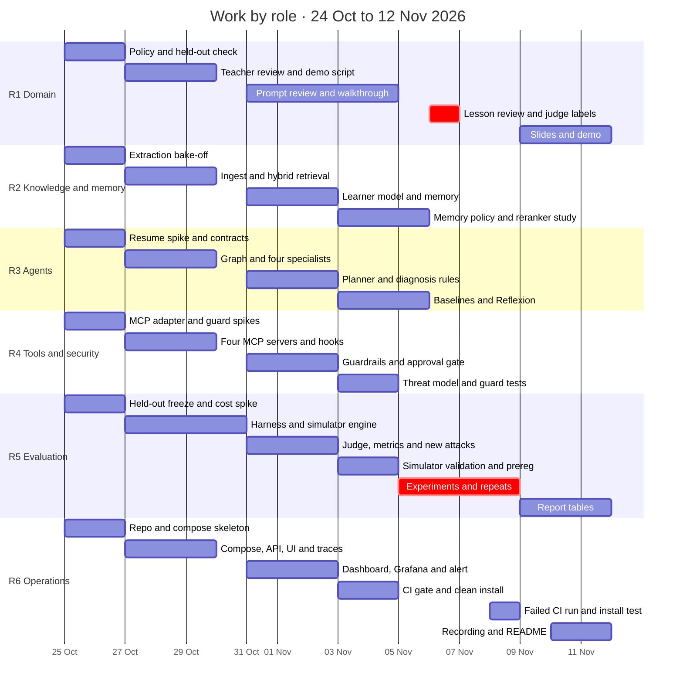

# 08 · Schedule

[← Team and roles](07-team-and-roles.md) · [Plan overview](README.md) · [Next: Delivery →](09-delivery.md)

> [!IMPORTANT]
> **Re-dated on Fri 30 Oct.** The [lead roadmap](../LEAD_ROADMAP.md) replaces Phases 0 and 1 below: the proof of concept stands in for the walking skeleton, and each role takes over its box from it. The dates from M2 (Mon 2 Nov) onward are unchanged.

The schedule runs from **Sat 24 Oct** to **Sun 15 Nov 2026**.

| Phase | Dates | Goal |
|---|---|---|
| 0 · Kickoff | Sat 24 – Mon 26 Oct | Decisions, spikes, interface contracts |
| 1 · Walking skeleton | Tue 27 – Fri 30 Oct | One request works end to end |
| 2 · Depth | Sat 31 Oct – Wed 4 Nov | Every feature built; agent behaviour frozen |
| 3 · Runs | Thu 5 – Sun 8 Nov | Experiments and human review |
| 4 · Write-up | Mon 9 – Thu 12 Nov | Documents, recording, submission |
| 5 · Viva | Fri 13 – Sun 15 Nov | Preparation and review |

Integration days are fixed: **Fri 30 Oct, Mon 2 Nov and Wed 4 Nov**.

> [!TIP]
> **If we adopt Q9**, Mon 26 – Fri 30 Oct follows the [proof-of-concept day plan](10-proof-of-concept.md#day-by-day), not the spikes and Phase 1 tasks below. The Phase 1 tasks the POC does not cover move to Sat 31 Oct – Mon 2 Nov.

## Phase 0 · Kickoff and spikes (Sat 24 – Mon 26 Oct)

### Sat 24 Oct · accounts and decisions

- Prepare the [open decisions](README.md#open-decisions).
- Collect the API keys provided by the faculty, and check which models they can reach.
- Every member installs Docker Desktop and requests Prompt Guard 2 access on Hugging Face.

### Sun 25 Oct · kickoff (2 hours) → **M0**

- **All:** walk through the plan; assign roles; agree the working agreements.
- **R6:**
  - Repository setup: `.gitignore`, branch protection, `CODEOWNERS`, the first commit of the plan and the dataset source.
  - Then the compose skeleton, which is spike S5.
- **R5:** freeze the held-out sets into `eval/private/`, and record the seed and hashes in `Docs/EXPERIMENT_LOG.md`.

**Spikes** are due Mon 26. Each one ends with a one-page result in `Docs/spikes/`.

| Spike | Owner | Question to answer |
|---|---|---|
| S1 | R4 | Can a FastMCP 4.1 server be called through `langchain.mcp.MCPAdapter` from a `create_agent` on gpt-4.1-mini via OpenRouter? If not, does the hand-written adapter work? |
| S2 | R3 | Can we `interrupt()` with `AsyncPostgresSaver`, kill the process, and resume in a new process? |
| S3 | R2 | Docling or PyMuPDF? Compare extraction on three pages: the quadratic formula, the AP sum derivation and the trig table. |
| S4 | R4 | Llama Guard 4 on OpenRouter: does it apply its template, and how do we parse its output? Also measure Prompt Guard 2 latency on CPU. |
| S5 | R6 | Does `docker compose up --wait` bring up postgres, chroma, prometheus and grafana? |
| S6 | R5 | Do the faculty-provided keys reach every model we plan to use? How many tokens and how much cost does one session take (which we must report as cost per case)? Measure on a 4-turn scripted C2 run. |

### Mon 26 Oct · contracts day

- **All:** freeze `Docs/contracts/`:
  - state schema;
  - tool input/output models;
  - trace event schema;
  - config schema;
  - lesson schema;
  - SSE event types;
  - approval-token format.

  Every service gets a stub that returns fixtures, so the API, the UI and the harness can be built against the stubs.
- **R1:** write the teaching and mode policy, the leak definition and the after-the-last-hint policy in `Docs/policy/TEACHING_POLICY.md`. Then check the held-out cases against it.
- **R6:** the CI skeleton, with the `test` job passing on the stubs.

## Phase 1 · Walking skeleton (Tue 27 – Fri 30 Oct)

**R1** (due Thu)
- Demo script v1.
- Teacher session on the misconception catalogue and rubric.
- Six explanation styles, each with examples for every chapter.

**R2** (due Thu)
- **Ingest job:** download, verify, parse with the S3 winner, chunk, add metadata, upsert.
- **Retrieval in `textbook-kb`:** bm25s, fastembed, RRF, reranker and query rewriting.
- **Labels with R5:** the 45 section queries, labelled **before tuning**.
- **Baseline:** Recall@5 on both query sets.

**R3** (due Thu)
- Graph skeleton: every node, conditional edges and the checkpointer.
- Planner with structured output.
- The four specialists, each a `create_agent` with six-slot prompts (v1).
- Self-correction loop wired to the output-guard stub.

**R4** (due Thu)
- The four FastMCP servers, with one test per tool.
- `math-tools` wraps the dataset kernel.
- Answer adapter v1.
- Hooks v1: role allowlist, learner pinning, budget, trace.
- Question-bank schema.

**R5** (due Fri)
- Harness skeleton: `eval.run`, configs, run manifest, code checkers, scorer commands.
- Simulator engine v1, with buggy rules for every misconception seeded in the 40 cards.
- A benchmark recorder that writes dataset-schema observations.

**R6** (due Thu)
- Dockerfiles and the full compose file with health checks.
- API: auth, `/chat` with SSE, `/chat/resume`, `/metrics`.
- Streamlit chat with a mode toggle and a plan panel.
- The trace table and callback, plus `scripts/trace.py`.

### Fri 30 Oct · integration day → **M1**

**Exit criterion:**
1. `docker compose up` brings up the stack.
2. The demo question about x² = 5x gets a streamed, cited Socratic hint.
3. The trace prints the full walkthrough of that request.
4. The tests pass in CI.
5. The baseline Recall@5 values are in the experiment log.

## Phase 2 · Depth (Sat 31 Oct – Wed 4 Nov)

| Role | Sat 31 Oct – Sun 1 Nov | Mon 2 Nov · integration → **M2** | Tue 3 – Wed 4 Nov → **M3** |
|---|---|---|---|
| **R1** | Review agent prompts against the policy; draft the walkthrough text | Run the demo script; list the gaps | Approve the pre-registration wording; prepare the lesson-review rubric |
| **R2** | Mastery model, misconception flags, styles table, store namespaces, summarisation, forget-me; class aggregates | Memory on/off switch works | Memory policy v1; reranker before and after, on both query sets |
| **R3** | Outer-fringe planner, replan triggers, stuck rule; diagnosis rules; fixtures for the two learners | Replan trace and stuck alert can be demonstrated | C0 and C1 baselines; Reflexion loop; first development iteration on Wed 4 |
| **R4** | Input and output guards; leak detector; citation validator; mode rules; approval gate with HMAC; profile limited to fixed-choice fields | An edit can be shown invalidating an approval | Threat model v1; guard tests; on/off switch for each defence layer |
| **R5** | Judge prompt and runner; leak and diagnosis metrics; secondary quiz answered by the LLM; at least 10 new attacks and controls (kept from R4) | Security runner writes dataset observations | Simulator validation; pre-registration frozen on Wed 4, with its hash logged; cost estimate refreshed |
| **R6** | Teacher pages; Grafana dashboards; alert provisioning; `fire_leak_alert.py` | Dashboard can be demonstrated | `eval-gate` job; compose smoke test; README v1; first clean install on a second machine |

**M2 exit:** every minimum-bar feature works at a basic level. Go/no-go on the [cut list](09-delivery.md#risks-and-cut-lines).

**M3 exit:**
- **Agent behaviour frozen**, except for the playbook.
- Every experiment configuration runs on 2 development cards without errors.
- Pre-registration hashed.
- CI green.

## Phase 3 · Runs (Thu 5 – Sun 8 Nov)

| Day | Work |
|---|---|
| **Thu 5** | R3 + R5: second Reflexion iteration, giving candidate lessons. R2: final retrieval numbers, before and after. R5: development runs of the golden set to check the harness end to end. |
| **Fri 6 · human day** | R1 (+ teacher): lesson review, with at least one rejection and its reason. R5: freeze the playbook (tag `playbook-v1`, record its hash). R1 + one member who does not tune agents: judge labels, then R5 computes kappa. Teacher or R1: approve question sets (recorded). |
| **Sat 7** | R5: E1 seed 1, E2, E3 seed 1, E4a, E4b and the deployment configuration. R6: watch the dashboards and fire the leak alert. |
| **Sun 8 → M4** | R5: E1 and E3 seeds 2 and 3, then results tables with spread. R6: the failed CI run, plus `Docs/ci_failure.md`; a clean-machine install by a member who has not run the stack before. All: check that every number traces back to a `run_id`. |

## Phase 4 · Write-up and submission (Mon 9 – Thu 12 Nov)

**Mon 9**
- R3 + R6: our redrawn architecture diagram, and the numbered walkthrough taken from a real trace.
- R4: final threat model.
- R2: final memory policy.

**Tue 10**
- Evaluation report draft: R5 leads, and each role writes its own section.
- R1: slides draft.

**Wed 11**
- R6 + R1: backup demo recording.
- Final README.
- Final clean install.
- Final report.

**Thu 12 → M5**
- Final checks:
  - no keys, PDFs, page images or private data in the repository;
  - `pip-audit` passes.
- Tag `v1.0`.
- **Submit by end of day.**

## Phase 5 · Viva (Fri 13 – Sun 15 Nov)

- **Fri 13:** each member redraws the architecture from memory and explains every box.
- **Sat 14:** mock viva. Each person answers the eight questions in [Viva preparation](09-delivery.md#viva-preparation), with their traces.
- **Sun 15:** review, demo and individual viva.

---

[← Team and roles](07-team-and-roles.md) · [Plan overview](README.md) · [Next: Delivery →](09-delivery.md)
