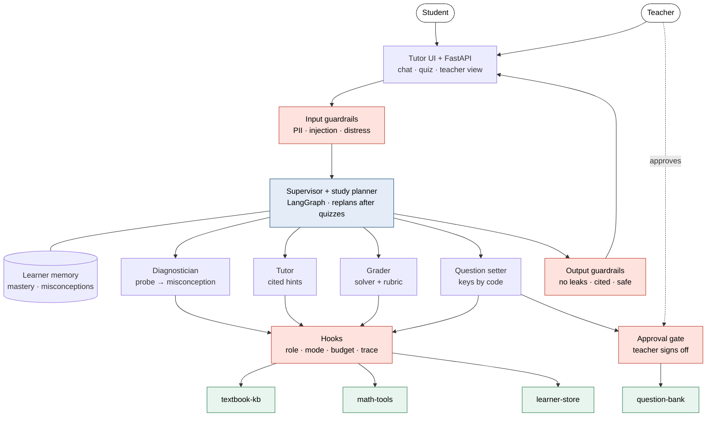
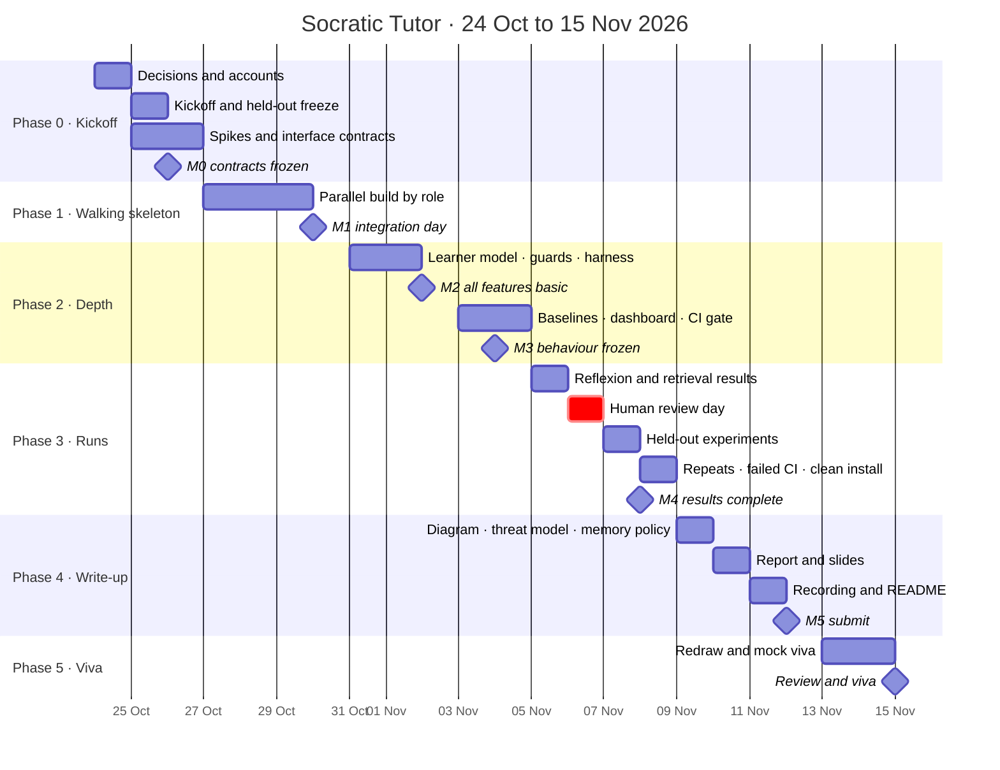

# Socratic Tutor · Proposed Project Plan

> An NCERT Class 10 Maths tutor that **teaches, not tells**: it finds what a student misunderstands, gives cited Socratic hints, checks work with a solver and plans practice from a learner model, with a teacher in control.

| | |
|---|---|
| **Project** | Agentic AI Capstone · Project 3 (Socratic Tutor) · team of six |
| **Scope** | Class 10 Maths in English: Quadratic Equations, Arithmetic Progressions, Introduction to Trigonometry |
| **Plan status** | **Proposed:** for team review before kickoff · version 2 · 24 Oct 2026 |
| **Builds on** | [Socratic Tutor — Agentic AI Architecture Guide](../Socratic%20Tutor%20%E2%80%94%20Agentic%20AI%20Architecture%20Guide.pdf) (Poonam, 19 Oct). See [how they relate](#how-this-plan-relates-to-the-architecture-guide) |
| **Kickoff** | Sunday 25 Oct 2026 |
| **Submission** | Thursday 12 Nov 2026, end of day |
| **Review, demo and viva** | Sunday 15 Nov 2026 |

> [!IMPORTANT]
> **Before kickoff:**
> - Read this page and the documents for your role (see [How to read this plan](#how-to-read-this-plan)).
> - Come ready to settle the [open decisions](#open-decisions).
> - Send comments as a pull request or issue rather than editing the plan directly.

---

## What we are building

A **student** chats with the tutor in practice or quiz mode. A **teacher** sees where the class is struggling, approves new question sets and receives alerts.

For each student message, the system:

1. Screens the message for personal details, prompt injection, signs of distress and unsafe content.
2. Loads that student's learner model: mastery per concept, misconceptions seen and explanations that worked.
3. Asks a probing question to find the misconception.
4. Gives a Socratic hint that is grounded in the NCERT textbook and cites it, without giving away the answer.
5. Checks the student's answers with a solver. The model never decides correctness.
6. Updates the learner model and revises the study plan over a prerequisite graph of 25 concepts.

The course weights two **signature challenges** most heavily:

- **A. A learner model that changes what the tutor does.** Two students asking the same question get different teaching, and the plan is revised after every quiz.
- **B. Measuring teaching with simulated students.**
  - 40 simulated students, each with a hidden card.
  - A Reflexion loop learns teaching lessons for each misconception on development students.
  - The final test uses held-out students.

Three rules hold everywhere:
- **The model proposes; code and people decide.**
- **Outside text is data, never instructions.**
- **A person approves every change to the outside world**, and the approval covers that exact change only.

## Architecture at a glance

Red boxes are control points: the guardrails, the hooks and the teacher's approval gate. Green boxes are MCP servers. The full design is in [04 · Architecture](04-architecture.md).

## Where we start

| Already done | Not started yet |
|---|---|
| A frozen, machine-verified **dataset (v0.10.0)**: • 25 concepts with prerequisites • 30 misconceptions • 665 practice items with 3-stage hints • 610 golden benchmark cases (160 development / 450 held-out candidates) • 52 matched quiz pairs • 40 hidden simulated-student cards • 42 retrieval queries • 30 attacks + 30 clean controls • a draft rubric | **Everything that runs:** • ingestion and index • MCP servers • agents and graph • guardrails and approval gate • API and UI • Docker Compose and CI • dashboards • experiments and report |

Research on 24 Oct 2026 changed three of the course guide's defaults:

| Guide default | Status now | What we use instead |
|---|---|---|
| `langchain-mcp-adapters` | Archived, and incompatible with current FastMCP | LangChain's built-in MCP adapter |
| `create_react_agent`, `langgraph-supervisor` | Deprecated / archived | `create_agent`, with a supervisor graph we build ourselves |
| Self-hosted Langfuse | Needs 16 GB of RAM on its own | Traces stored in Postgres |

Details: [02 · Starting point](02-starting-point.md#what-changed-since-the-course-guide).

## How this plan relates to the Architecture Guide

The *Socratic Tutor — Agentic AI Architecture Guide* (Poonam, 19 Oct, in `Docs/`) sets out the architecture, the six roles, the hand-offs and the folder ownership. **This plan builds on it.** It keeps the same architecture, the same roles (R1–R6) and the same separation rules. It adds:
- concrete dates up to the 12 Nov submission;
- the dataset we already have;
- stack updates from research done on 24 Oct.

Where the two differ:

| Topic | Architecture Guide | This plan proposes | Why |
|---|---|---|---|
| Scope | Science or Maths; pick one early | Class 10 Maths: Quadratic Equations, AP, Trigonometry | Already chosen, and the dataset is built for it |
| Concept graph, misconceptions, gold questions, student cards | R1 writes them | They already exist in dataset v0.10.0. R1 reviews and adopts them; R5 freezes the held-out sets | Saves about a week. Human review is still required |
| Supervisor model | `gpt-4.1-mini` | `gpt-4.1`; specialists stay on `gpt-4.1-mini`, and E1 uses mini for every role | The course guide asks for a stronger coordinator |
| Loading MCP tools | `langchain-mcp-adapters` | LangChain's built-in MCP adapter (`langchain[mcp]`) | `langchain-mcp-adapters` was archived on 17 Sep 2026 and does not work with FastMCP 4 |
| BM25 library | `rank-bm25` | `bm25s` | No `rank-bm25` release since 2022 |
| Traces | LangSmith or self-hosted Langfuse | A Postgres trace table, with Langfuse Cloud optional | Self-hosted Langfuse needs 16 GB of RAM |
| Repository layout | `src/tutor/`, `content/`, `config/`, `ops/`, `docs/`, with a named owner per folder | The layout in the [appendix](appendix.md#b-repository-layout) | Settle at kickoff ([Q1](#open-decisions)). We recommend the guide's layout and ownership table |
| Timeline | A 10-week template with three gates | Dated milestones; the guide's gates map to M0 (contracts frozen), M1 (one session end to end) and M3 (feature freeze) | Fits our submission date |

## Timeline

| Milestone | Date | Exit criterion |
|---|---|---|
| **M0** Kickoff | Sun 25 Oct (contracts Mon 26) | Roles named; API key works; held-out sets frozen; first commit pushed; interface contracts frozen |
| **M1** Walking skeleton | Fri 30 Oct | `docker compose up`, then the demo question gets a streamed, cited Socratic hint; full trace recorded; tool tests pass in CI |
| **M2** All features basic | Mon 2 Nov | Every minimum-bar feature works at a basic level; go/no-go on the cut list |
| **M3** Behaviour frozen | Wed 4 Nov | Every experiment configuration runs on development cases; pre-registration hashed; CI green |
| **M4** Results | Sun 8 Nov | E1–E4 done, with three repeats where required; failed CI run explained; clean-machine install done |
| **M5** Submission | Thu 12 Nov | Tag `v1.0` submitted |

Day-by-day tasks for each role are in [08 · Schedule](08-schedule.md).

## Team roles

| Role | Name | Owns |
|---|---|---|
| **R1** Domain and product lead | _TBD_ | Teaching policy; misconceptions and rubric (with the teacher); held-out policy check; lesson review; demo script; slides |
| **R2** Knowledge and memory engineer | _TBD_ | NCERT ingestion; hybrid retrieval; learner model and memory; memory policy |
| **R3** Agents and orchestration engineer | _TBD_ | LangGraph graph; planner; four specialists; baselines; Reflexion loop |
| **R4** Tools, control and security engineer | _TBD_ | Four MCP servers; hooks; guardrails; approval gate; answer adapter; threat model |
| **R5** Evaluation and red-team engineer | _TBD_ | Held-out sets; attacks; harness; simulated students; judge calibration; experiments; report tables |
| **R6** Deployment and operations engineer | _TBD_ | Docker Compose; API; UI; auth; Prometheus and Grafana; alerts; CI; README; recording |

Two separations keep the results honest:
- R3, who tunes the agents, never sees the held-out cases.
- R4, who builds the defences, never sees R5's new attacks before the security experiment.

Details: [07 · Team and roles](07-team-and-roles.md).

## How to read this plan

| Document | Contents | Read it if you are |
|---|---|---|
| [01 · Requirements](01-requirements.md) | What the course guide requires, traced to plan sections and evidence | Everyone |
| [02 · Starting point](02-starting-point.md) | Dataset assets and gaps; reusable HW2 code; current package versions; setup | Everyone; R2–R5 in depth |
| [03 · Decisions](03-decisions.md) | 20 design decisions, with reasons and the options we rejected | Everyone |
| [04 · Architecture](04-architecture.md) | Services, a request from start to finish, graph, agents, tools, hooks, approval, guardrails, learner model, retrieval, observability, CI | R2, R3, R4, R6 |
| [05 · Evaluation](05-evaluation.md) | Data splits, checkers, simulated students, metrics, judge calibration, Reflexion, experiments E1–E4 | R5, R3, R1 |
| [06 · Security and privacy](06-security-and-privacy.md) | Threat model, attack suite, memory policy, minors and Indian law | R4, R5, R2, R1 |
| [07 · Team and roles](07-team-and-roles.md) | Ownership, separation rules, working agreements, human-only tasks | Everyone |
| [08 · Schedule](08-schedule.md) | Day-by-day plan for each role, with milestones | Everyone |
| [09 · Delivery](09-delivery.md) | Deliverables, budget, risks and cut lines, viva preparation | Everyone |
| [Appendix](appendix.md) | Configuration skeleton, repository layout, sources | As needed |

## Open decisions

To settle at kickoff on Sun 25 Oct.

| # | Decision | Recommendation | Owner |
|---|---|---|---|
| **Q1** | Repository layout and rules | Adopt the Architecture Guide's layout and folder-ownership table. The plan's paths are then updated to match, replacing the [appendix](appendix.md#b-repository-layout) layout. Every change goes through a pull request with one review, and `CODEOWNERS` enforces ownership. | R6 |
| **Q2** | Repository visibility | Private until the review on 15 Nov | All |
| **Q3** | Names for R1–R6, and a maths teacher to review misconceptions, rubric, lessons and question sets | Settle at kickoff. If no teacher is available, R1 acts as teacher and the report says so. | All |
| **Q4** | OpenRouter account | One team key with a hard $150 limit. It lives in GitHub secrets and in each member's local `.env`, and is never committed. | R6 |
| **Q5** | Local setup | Docker Desktop on every member's machine, with at least 8 GB of memory for WSL2. At least two machines run the full stack (one is needed for the clean-install test). | Each member |
| **Q6** | Access to Prompt Guard 2 on Hugging Face | Each member who runs the stack requests access personally. The form asks for legal name, date of birth and organisation. | Each member |
| **Q7** | Traces leaving our machines | By default, traces stay in Postgres. If we want a trace UI, use Langfuse Cloud (free tier, with masking) for synthetic runs only. | R6 + R2 |
| **Q8** | Independence rules (D19) and pre-registration (D20) | Accept both | All |

## Project integrity rules

- **No human step is generated or inferred.** That covers approvals, reviews, labels and independent authorship. It counts only once the named person has done it.
- **Hidden material stays hidden.** Held-out cases, simulated-student cards and new attacks belong to R5 and stay out of the agents' reach.
- **Some things never go into git:** API keys, NCERT PDFs or page images, text derived from the textbook, and personal data.
- **AI-assisted code must be understood by its owner.** AI coding tools may write code, but each owner must be able to explain, change and defend it in the viva. Record AI-assisted work in the contribution log.
