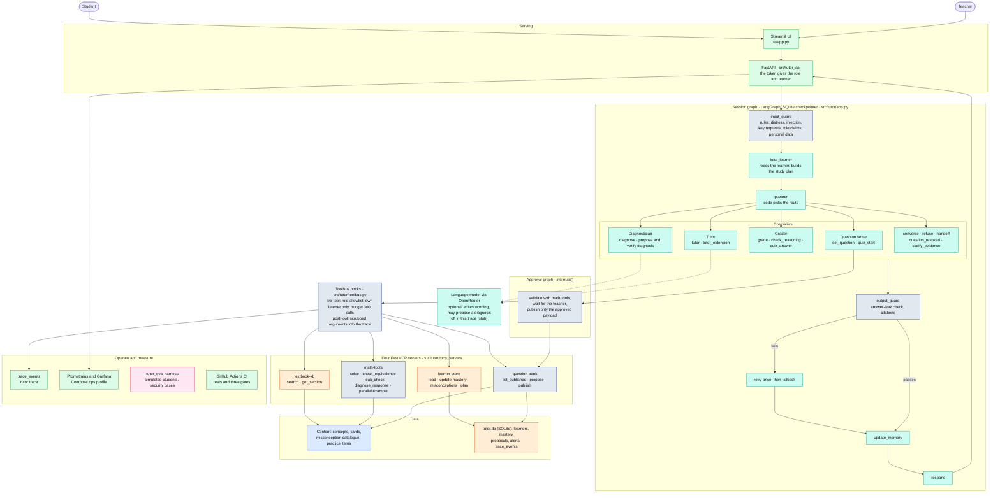

# Architecture: diagram and one real request

Owners: R3 (graph, planner, specialists) with R6 (API, UI, operations). This is our redraw of Figure 4 in the course guide, using the names in our code, followed by a numbered walkthrough of one real trace. The report's section 2 refers to this page.

## The diagram

Each box is coloured by the role that builds it, as in the guide. Arrows show what calls what.



**Colour key:** blue R1 · orange R2 · teal R3 · grey-blue R4 · pink R5 · green R6.

## One real request, step by step

**The run.** Learner A, the seeded demo learner who already has misconception `qe_m04` suspected, in practice mode, session `walk-1`. Offline with `TUTOR_LLM=stub`, so every reply comes from code templates and no model is called. The full trace is in [walkthrough_trace.txt](walkthrough_trace.txt). The row numbers below are its row numbers. Rerunning the commands at the end gives the same 36 rows; only the timings change.

### Turn 1: *"I solved x² = 5x by dividing both sides by x and got x = 5. Why is there another answer?"*

| Step | What happens | Trace rows | Built by |
|---|---|---|---|
| 1 | **Request in.** This run uses the command line (`tutor ask`). The API does the same through `POST /chat`, taking the role and learner only from the token. | none | R6 |
| 2 | **Input guard.** Rule checks find no distress, injection, answer-key request, role claim or personal data. The message contains the student's own equation, so it is flagged as an unverified problem: the tutor may not check an answer it has no key for, and replies stay deterministic. | 1–2 | R4 |
| 3 | **Load the learner.** `learner-store.read_learner`, then the first study plan for this session: review prerequisite `qe04` first, because `qe_m04` is flagged and `qe03` is weak. | 3–4 | R3 (planner), R2 (store) |
| 4 | **Planner.** Code, not a model, compares the flagged misconception with keywords in the message. Both point to `qe_m04`, so the route is `diagnose`. | 5–6 | R3 |
| 5 | **Diagnostician.** Asks one probing question from the misconception catalogue: *"Could the factor you divided by be zero?"* | 7 | R3, R1 (catalogue) |
| 6 | **Output guard.** Passes. There is no answer key for the student's own problem, so it records that the reply was not answer-checked. | 8 | R4 |
| 7 | **Memory.** Records `qe_m04` as suspected, with the evidence "keywords in the student's message". | 9–10 | R2 |

### Turn 2: *"I think dividing is fine"*

| Step | What happens | Trace rows | Built by |
|---|---|---|---|
| 8 | **Tutor.** The planner routes to `tutor`. The tutor searches the textbook (`textbook-kb.search`, this chapter only, top 2) and gives a Socratic hint that cites `[normalized:qe04]` instead of the answer. The output guard passes, and memory marks `qe_m04` as addressed. | 11–19 | R3, R2 (retrieval), R4 (guard) |

### The teacher approves a question set (its own graph, session `qs-…`)

| Step | What happens | Trace rows | Built by |
|---|---|---|---|
| 9 | **Approval gate.** The question setter proposes three `qe04` items. The gate solves each one with `math-tools.solve`, stops at `interrupt()` until the teacher acts, and publishes only the payload whose SHA-256 the teacher approved. Nothing reaches students before this. | not in `walk-1`; see `tutor teacher` | R4, R3 (graph) |

### Turns 3 and 4: *"practice"*, then *"no real roots"*

| Step | What happens | Trace rows | Built by |
|---|---|---|---|
| 10 | **Question setter.** Picks a published `qe04` item, and `math-tools.solve` computes its key in code before the question is shown. A question is not leak-checked, so there is no output-guard row. | 20–25 | R3, R4 (math-tools) |
| 11 | **Grader.** The input guard first checks that the question is still published. The planner then routes to `grade`, and `math-tools.check_equivalence` marks "no real roots" correct. The trace stores the answer only as `<13 chars>`, because the post-tool hook scrubs student text. | 26–31 | R3, R4 |
| 12 | **Memory.** Mastery goes up for `qe03`, `qe04` and `qe05`, and the explanation style that worked (`counterexample` for `qe_m04`) is recorded. | 32–36 | R2 |

## Where we differ from Figure 4

- **Supervisor and planner.** Code chooses the route. A model, when one is configured, only writes the wording and may propose a diagnosis that code then verifies. See [R3_SPECIALISTS.md](../m3/R3_SPECIALISTS.md), which is still a proposal.
- **Specialists.** They are graph nodes, each limited by a role allowlist in the ToolBus, not ReAct loops. The model never chooses a tool.
- **Guardrails.** Both guards are deterministic rules. Llama Guard 4 and Prompt Guard 2 are not in the code; `guards.py` says they slot in once model access is confirmed.
- **Answer-leak check.** It runs while a question is open. In turn 4 the question was already answered correctly, so row 31 passes without calling `leak_check`.
- **Retrieval.** The default backend is chapter-scoped BM25 over the reference cards. Hybrid search over NCERT sections is an option in `config/app.toml`.
- **Storage.** SQLite for the learner store, the trace and the checkpointer. The Vercel beta uses Postgres; the team stack does not yet.
- **Not shown in this trace:** replanning after a quiz, the distress handoff, and a model-written reply.

## Reproduce the trace

Run in a temporary data folder, because `tutor setup` resets the folder it uses:

```bash
export TUTOR_LLM=stub TUTOR_VAR_DIR="$(mktemp -d)"
tutor setup
tutor ask --learner A --session walk-1 "I solved x² = 5x by dividing both sides by x and got x = 5. Why is there another answer?"
tutor ask --learner A --session walk-1 "I think dividing is fine"
tutor teacher propose --concept qe04
tutor teacher approve "$(tutor teacher pending | grep -o 'set-[0-9a-f]*' | tail -1)"
tutor ask --learner A --session walk-1 "practice"
tutor ask --learner A --session walk-1 "no real roots"
tutor trace walk-1 > Docs/report/walkthrough_trace.txt
```
